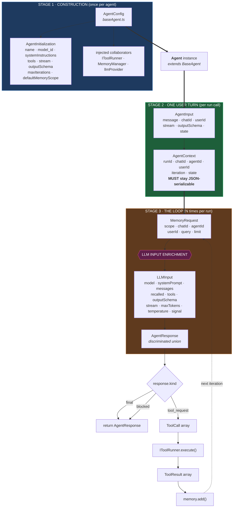
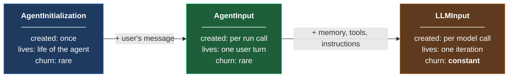
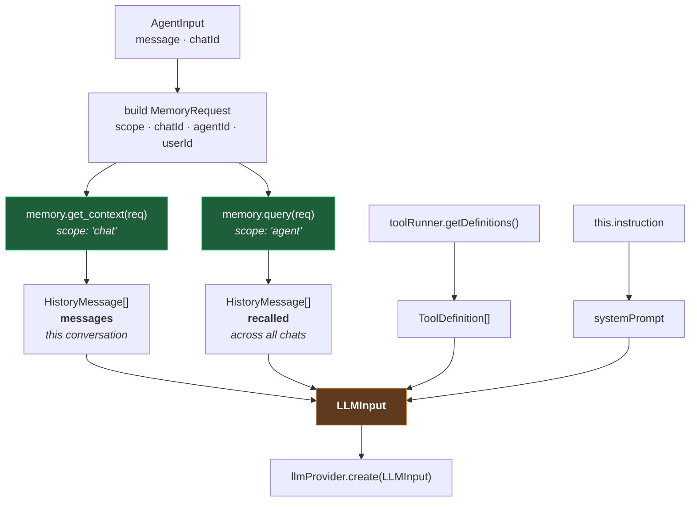
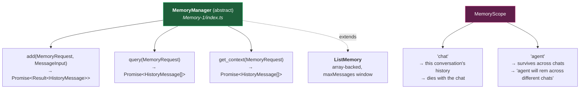
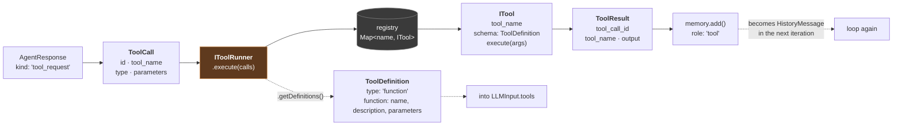
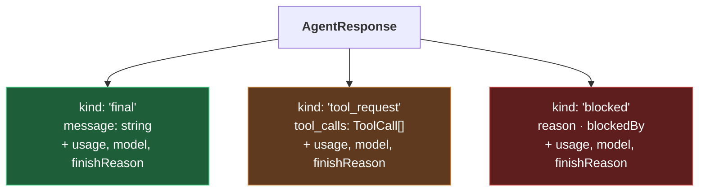
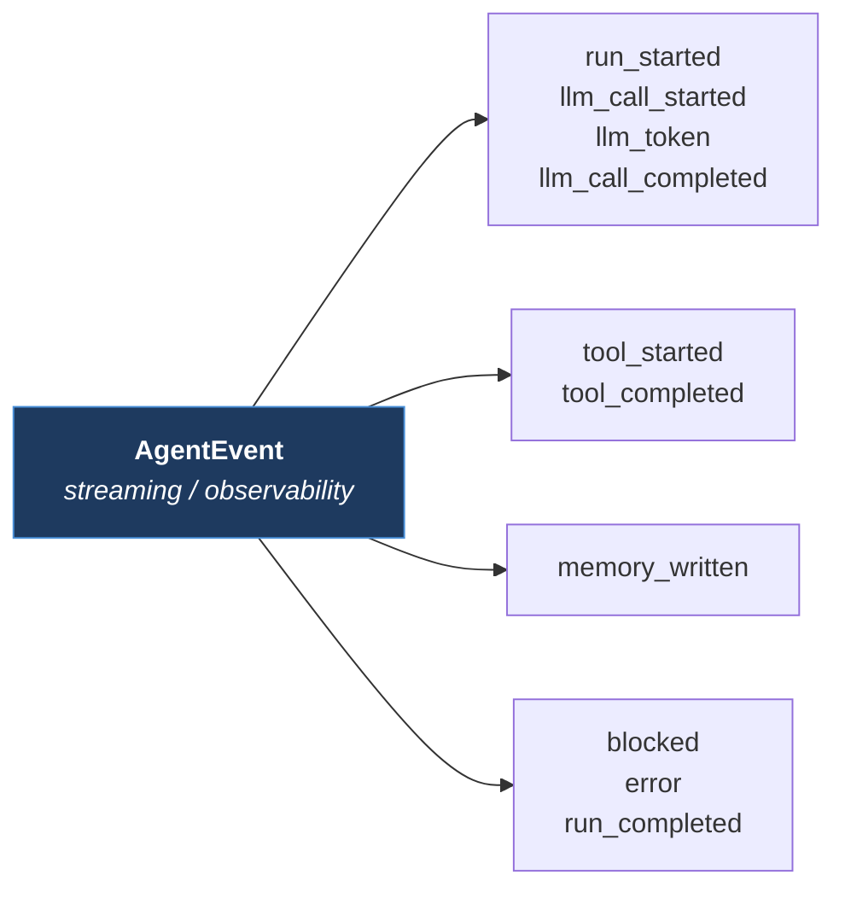
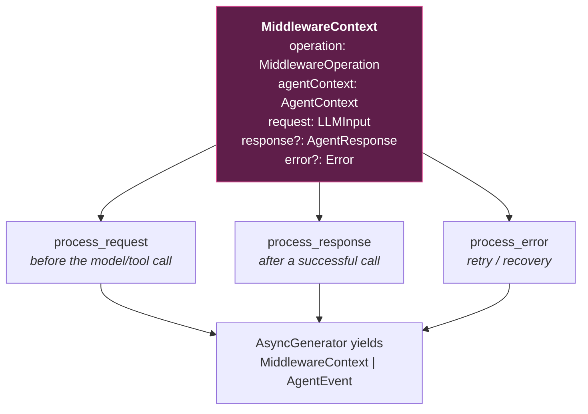
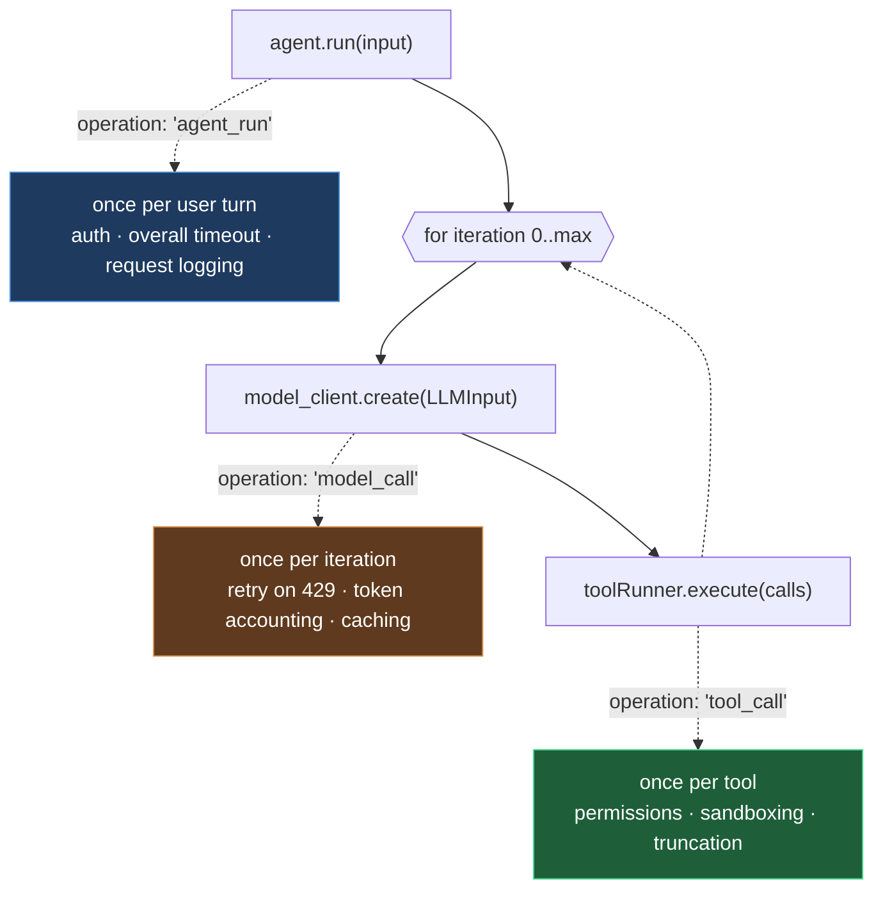

# Type Flow — Agent Orchestration

Every type currently in the repo, and where it lives in the request lifecycle.

---

## 1. The master flow



---

## 2. Three lifetimes — why these are three different types

The single most important thing on the whiteboard was the **vertical dividing lines**.
They are layer seams, and each stage has its own type because each has its own *lifetime*.



**The test for "is this type stable?"**

> Would it still exist if you swapped OpenAI → Anthropic? in-memory → Redis? dropped tools?

| type | survives? | verdict |
|---|---|---|
| `HistoryMessage`, `AgentResponse`, `TokenUsage`, `Role` | yes | **domain type** — slow-changing |
| `AgentInitialization`, `AgentInput` | yes | **domain type** |
| `LLMInput` | **no** — `signal`, `outputSchema`, `temperature` are provider concerns | **boundary type** — expected to churn |

`LLMInput` churning is **normal**. That was difficulty #2 — the mistake was expecting it to be stable.

---

## 3. The enrichment step (the heart of it)

The left-hand note on the whiteboard said *"LLM Input enrichment!"*. This is it — a thin
`AgentInput` becomes a fat `LLMInput`, and everything added comes from an injected collaborator.



**Why `messages` and `recalled` stay separate:** a flat array would force the memory layer
to decide how recalled facts are expressed. Keeping them apart pushes that decision down
to the provider, where it belongs — OpenAI puts recall in a system block; another provider
may want it inline. Same lesson as the adapter pattern in difficulty #4.

---

## 4. Memory — the scope axis



`MemoryRequest` carries the scope on **every** call. Without it, one user's conversation
leaks into another's prompt — that is a correctness issue, not a nicety.

---

## 5. Tool execution



The registry is why adding a tool never edits `ToolRunner` or the agent loop — OCP,
from difficulty on the tool runner.

**Note the arrow back into memory.** Tool results are no longer concatenated into a local
string that dies when `run()` returns — they become real `HistoryMessage` rows, which is
the `Tools_output / chat-Id (memory → tx)` arrow on the whiteboard.

---

## 6. The two discriminated unions

These are the types that make illegal states **unrepresentable** rather than merely discouraged.



**What the old shape allowed:**

| `message` | `tool_calls` | legal? |
|---|---|---|
| `"hi"` | `undefined` | yes — final answer |
| `null` | `[...]` | yes — tool request |
| `null` | `undefined` | **no** — nothing happened |
| `"hi"` | `[...]` | **no** — the loop silently dropped the message |

Row 4 was a live bug: `if (!response.tool_calls?.length)` meant a response carrying both
would take the tool branch and discard the text with no error. The union makes rows 3 and 4
impossible to construct.



---

## 7. Middleware — and the `operation` key



### The interception points

An agent has **more than one** place middleware can wrap, and they are not the same.
`operation` says which one this invocation is at.



| `operation` | fires | what belongs here |
|---|---|---|
| `agent_run` | once per user turn | auth, overall timeout, request logging |
| `model_call` | once per loop iteration (**N times**) | retry on 429, token accounting, model fallback, caching |
| `tool_call` | once per tool execution | tool permissions, sandboxing, truncating huge outputs |
| `memory_access` | per memory read/write | audit logging, PII scrubbing before storage |

**Why the field is necessary.** Without it, `response` is ambiguous — a
`process_response` running at `model_call` sees the result of iteration 4, while one
running at `agent_run` sees the final answer. Same method, same context type, completely
different meaning. A token counter wants `model_call`; a "log the final answer"
middleware wants `agent_run`. `operation` is what lets a middleware tell them apart and
ignore the invocations it does not care about:

```
if (context.operation !== "model_call") { yield context; return; }
```

**Open modelling question:** `request` is typed `LLMInput`, which fits `model_call`
cleanly but not `tool_call` — a tool invocation's request is really a `ToolCall`, not an
`LLMInput`. Either widen `request` to a union, or give the tool interception point its
own context type.

## 8. Full type reference

### `src/globalTypes.ts`

| § | type | kind | purpose |
|---|---|---|---|
| 1 | `ChatId` `AgentId` `UserId` `RunId` `MessageId` | alias | readable scope at call sites |
| 2 | `Role` | union | `user` / `assistant` / `system` / `tool` |
| 2 | `HistoryMessage` | interface | the stored unit — id, role, content, timestamp, chatId |
| 2 | `MessageInput` | interface | what a caller supplies; ids stamped by memory |
| 3 | `Result<T,E>` | **union** | `{ok:true,value}` \| `{ok:false,error}` |
| 4 | `MemoryScope` | union | `chat` \| `agent` |
| 4 | `MemoryRequest` | interface | the one object all 3 memory methods take |
| 5 | `AgentContext` | interface | transient run state — **JSON-serializable** |
| 6 | `AgentInitialization` | interface | construction-time settings |
| 7 | `AgentInput` | interface | one user turn |
| 8 | `LLMInput` | interface | the enriched provider request |
| 9 | `TokenUsage` | interface | input / output / total |
| 9 | `FinishReason` | union | stop, tool_calls, length, content_filter, blocked, error |
| 9 | `AgentResponse` | **union** | final \| tool_request \| blocked |
| 10 | `AgentEvent` | **union** | 10 event kinds |
| 11 | `MiddlewareContext` | interface | agentContext + request + response? + error? |

### `src/Agents/toolRunner/types.ts`

| type | kind | purpose |
|---|---|---|
| `ToolCall` | interface | a tool the model asked for, provider-normalized |
| `ToolResult` | interface | what came back, keyed by `tool_call_id` |
| `ToolDefinition` | interface | the schema handed to the LLM |
| `ITool` | interface | one executable tool (Strategy) |
| `IToolRunner` | interface | the collaborator the agent depends on |

### Elsewhere

| type | file | purpose |
|---|---|---|
| `AgentConfig` | `Agents/baseAgent.ts` | `AgentInitialization` + the 3 collaborators |
| `BaseAgent` | `Agents/baseAgent.ts` | abstract — `run` / `run_stream` |
| `MemoryManager` | `Agents/Memory-1/index.ts` | abstract — `add` / `query` / `get_context` |
| `llmProvider` | `llmProviders/lllmProvider.ts` | abstract — `create` / `create_stream` |
| `BaseMiddleware` | `Agents/middleware/index.ts` | abstract — the 3 process methods |

---

## 9. Open items

| # | issue | why it matters |
|---|---|---|
| 1 | **`middleware/index.ts` redeclares `MiddlewareContext` and `AgentEvent` as empty interfaces** | two definitions of the same name will drift — import from `globalTypes` instead |
| 2 | Middleware is never called by the loop | `MiddlewareContext` exists, nothing constructs it |
| 3 | `userId` ignored by `ListMemory` | two users sharing an agent would mix agent-scoped memory |
| 4 | `ListMemory.query` / `get_context` start at `i = maxMessages` | reads one past the end; uses capacity, not `messages.length` |
| 5 | `query` never assigns `queryString` from the request before lowercasing | comparison always runs against `''` |
| 6 | `role: "tool"` replayed as assistant text | real tool messages need the assistant's `tool_calls` payload stored first |
| 7 | No `AgentOutput` wrapper | `run()` returns `AgentResponse` directly; whiteboard listed a separate output type |

---

## 10. One-line summary

```
AgentConfig ──once──> Agent ──per turn──> AgentInput ──enrich──> LLMInput ──> AgentResponse
                                               │                    ▲              │
                                               │                    │              ├─ final ──> return
                                               └──> MemoryRequest ──┘              ├─ blocked ─> return
                                                         │                         └─ tool_request
                                                    HistoryMessage[]                      │
                                                         ▲                           ToolCall[]
                                                         │                                │
                                                         └────── ToolResult <──── IToolRunner
```
